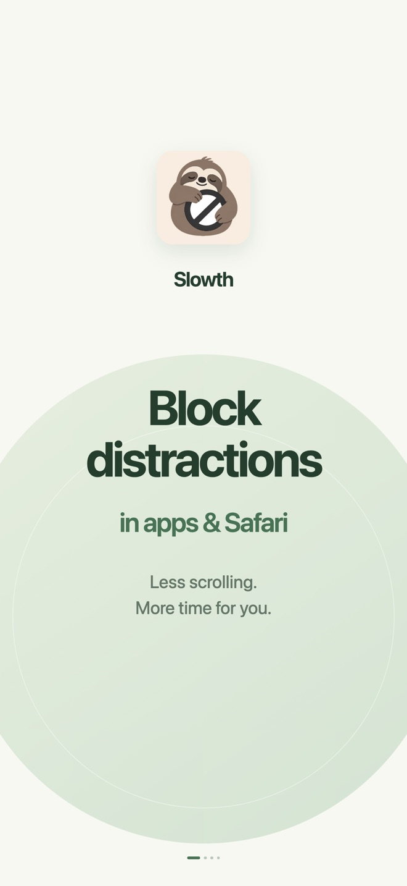
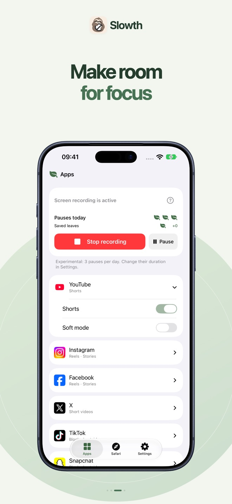
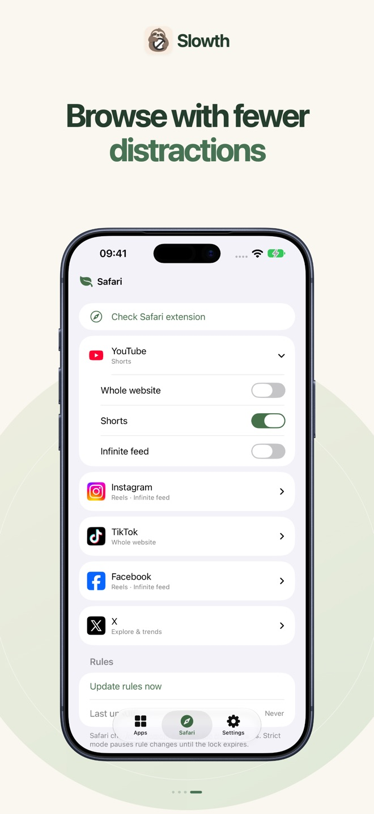

<div align="center">


# Slowth

**Infinite scroll is a bug. This is the patch.**

Take a break from Shorts, Reels, and endless feeds without giving up the rest
of your favorite sites. Slowth offers Safari blocking on iPhone, iPad, and Mac,
and optional content detection inside supported iPhone and iPad apps.
Free and open source. No account required. No tracking.

[](https://apps.apple.com/us/app/slowth-short-video-blocker/id6764140763)
[](https://malina.page/slowth/)
[](LICENSE)

[GitHub Releases](https://github.com/skar404/slowth/releases) · [Support development](#development-and-support)

</div>

<p align="center">
  
  
  
</p>

## Try Slowth

Install from the App Store, open Slowth, and follow the setup instructions.
For Safari, enable the extension, grant access to the supported websites, and
choose what to hide or block. Safari blocking does not need screen recording.
Mac users can also download `Slowth-macOS.zip` from a stable GitHub release.

Native app blocking is optional: allow Screen Time access, select the apps,
and start the screen broadcast through Apple's system prompt when you want
content detection. See below for how it works and its limits.

## What it does

| Feature | Safari on iPhone, iPad, and Mac | Native apps on iPhone and iPad |
| --- | --- | --- |
| Selected content | Hide YouTube Shorts, Instagram/Facebook Reels, and X Explore and trends; limit supported infinite feeds | Recognize supported Shorts, Reels, and Stories on-device, then temporarily block app access |
| Whole-site or app blocking | Block any of the five supported sites; TikTok is blocked as a whole site | Protect selected apps using Apple's Screen Time controls |
| Pauses | Temporary access on iPhone/iPad through the pause controls | Temporarily allow access; detection can trigger a rest before access resumes |
| Strict mode | Lock restrictions for 24 hours | Lock blocking settings, with a configurable policy for pauses |

Safari offers separate content and whole-site controls. YouTube, Instagram,
and Facebook have Infinite Feed controls; X targets Explore and trends;
TikTok has whole-site blocking. “Block site” applies to these supported sites,
not an arbitrary website list.

Strict mode prevents weakening restrictions until its timer expires and
survives app restarts. It is a commitment aid, not tamper-proof parental control.

## How it works and privacy

**In Safari**, the extension hides selected page elements, limits supported
feeds, or redirects blocked pages. Settings are stored locally and shared
between Slowth and its extensions. Blocking rules are downloaded over HTTPS
from a public list and cached on-device so website fixes can arrive without an
app update. Strict mode defers saving rule updates until the lock expires.

**Inside native apps**, Slowth uses two Apple features together:

1. **Screen Time permission** lets Slowth block the apps you select. Apple
   represents the selection with privacy-protected tokens.
2. **A screen broadcast you start yourself** supplies screen images to an
   on-device Core ML model. When supported content is detected, Screen Time
   blocks app access rather than removing just the video or story.

Screen images are processed locally, audio is ignored, and the production app
does not save or upload screen frames. Developer Debug builds have explicit
capture tools that are excluded from Release builds. Detection needs an active
broadcast; stopping it does not necessarily unblock protected apps.

Slowth has no account system or tracking analytics. Local recognition does not
require a remote inference service, but the app is not entirely network-free:
Safari downloads public blocking rules. Recognition can make mistakes, and
website or app updates can affect blocking behavior.

## Current status

As of **November 4, 2026**, the latest stable GitHub app release is
[2026.10.8](https://github.com/skar404/slowth/releases/tag/v2026.10.8), and the latest
prerelease is [2026.11.1rc2](https://github.com/skar404/slowth/releases/tag/v2026.11.1rc2).
These are GitHub release states, not confirmation of the version available in
the App Store. Check the store listing for your platform and region.

Released functionality includes Safari filtering, native content blocking,
pauses, and strict mode. The App Store description covers YouTube Shorts and
Instagram Reels/Stories; the current source also contains recognition paths for
Facebook Reels/Stories and X short videos.

**Current source / prerelease:** the newer interface offers one grouped app
selection, shared pauses, and per-app content exceptions. Selecting an arbitrary
app does **not** add recognition support for its content. Detection remains
limited to the content types supported by the model; a detection can block
multiple selected apps according to their rules. This grouped interface is not
part of stable GitHub release 2026.10.8.

The current Release code uses **Flat 15** for native content recognition.
Model conversion checks and automated tests do not establish recognition
quality on every device or independent real-world validation.

## Development and support

Slowth is maintained by **Denis Malin** as a free, open-source project, with
long-term support planned through grants and voluntary donations and no
mandatory subscription.

The current funding request is **USD 10,000, one time, for six months after
funding is received**. This is a proposal, not an announcement of an awarded
grant. The [published budget](BUDGET.md) and [funding manifest](funding.json)
describe the allocation and expected results.

Funding would support:

- Clearer onboarding, navigation, blocking controls, and explanations of pauses.
- Better recognition data, evaluation, accuracy, and performance, with documented limitations.
- Apple-platform fixes and compatibility testing, including iPad.
- Independent review of building from public source, dependencies, and release procedures.
- Android feasibility research and an experimental prototype, plus outreach and supporting infrastructure.

Android work does not promise a production release. Independent build
verification is not a full security audit or a guarantee of byte-for-byte
identity with an App Store download. Main implementation is planned for months
1–3, followed by testing, verification, and refinements in months 4–6. Product
research and project coordination are the maintainer's unpaid contribution.

For funding or collaboration, contact [denis@malina.page](mailto:denis@malina.page).
For bugs and feature requests, use [GitHub Issues](https://github.com/skar404/slowth/issues).

## For developers

| Component | Role |
| --- | --- |
| `Shared/`, `App/`, `iOS/` | SwiftUI host apps, settings, and platform integration |
| `WebExt/`, `Extension/`, `ExtensionIOS/` | Safari scripts and native messaging handlers |
| `RealtimeShield/` | ReplayKit screen processing and Core ML recognition |
| `iOS/Blocking/` and iOS helper extensions | Screen Time enforcement, pause state, and shields |
| `scripts/`, `project.yml` | Build/release tooling and the XcodeGen project definition |

Build on macOS with Xcode, XcodeGen, Python 3, and Node.js. The current CI uses
Xcode 27.1, XcodeGen 2.46.0, Python 3.12.9, and Node 22.14.0; see the
[build and provenance guide](docs/BUILD_TRUST.md) for requirements, signing,
and verification details. Device distribution requires the appropriate Apple
signing setup and Family Controls entitlements.

**A clean public checkout needs the public model bundle.** Download
`Slowth-models.tar.gz` from the matching
[model release](https://github.com/skar404/slowth/releases/tag/models-flat-15-seed7-20261028).
The build tooling checks the pinned model inputs and prepares an isolated
Release build without the private training dataset:

```sh
python3 scripts/release.py build \
  --model-bundle /absolute/path/to/Slowth-models.tar.gz \
  --output /tmp/slowth-public-build
```

Use a new output directory. This local command validates unsigned Release
archives; it does not upload or publish an app. Local Debug builds may reference
additional private experimental resources, so start with the public Release
build path above.

Further reading: [iOS blocking architecture](iOS/Blocking/README.md),
[Safari tests](WebExt/tests/README.md), and
[build provenance and release verification](docs/BUILD_TRUST.md).
The latter explains what signed releases and attestations establish and their limits.

## License

Slowth's code is licensed under [GNU GPLv3](LICENSE). Distributed model resources
covered by the [model license notice](RealtimeShield/MODEL_LICENSE.md) are also
licensed under GPLv3. The private training dataset and captures are not
published and are not covered by that model notice.
